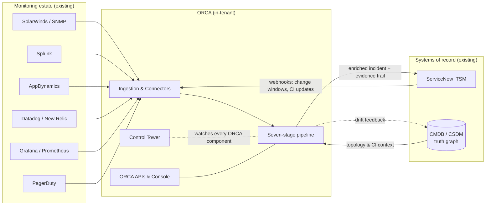
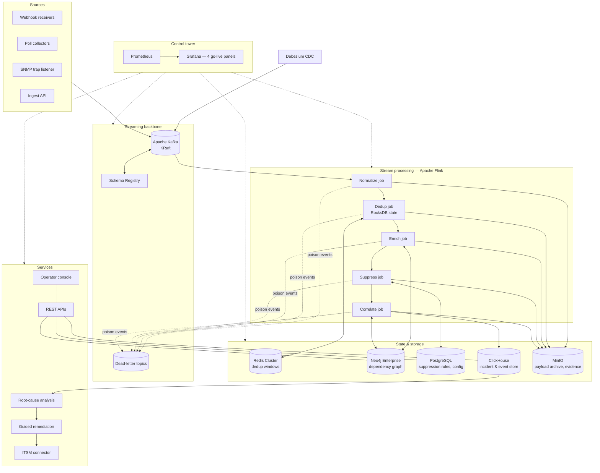
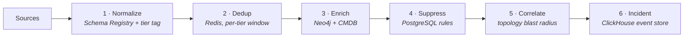
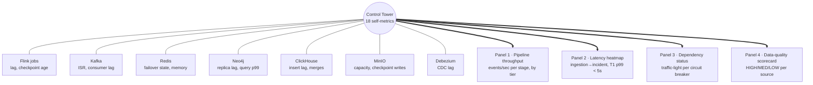
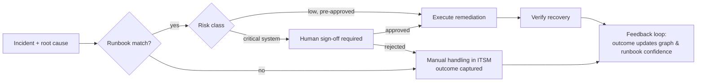
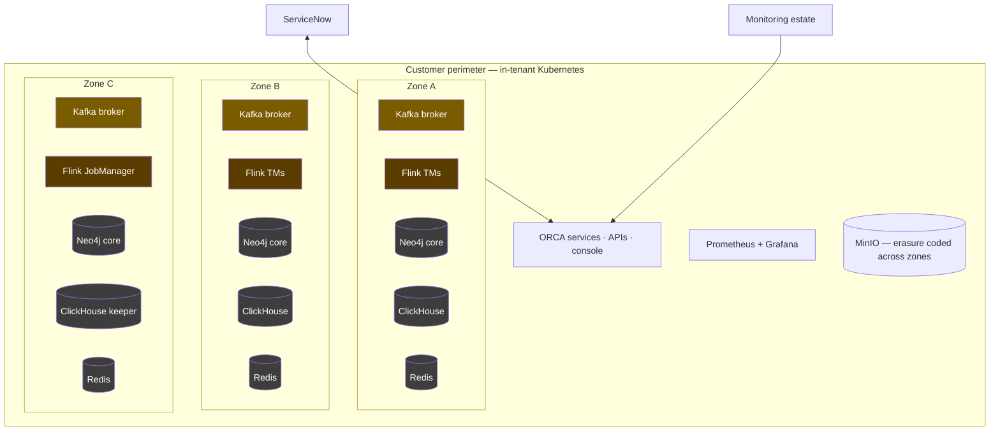

This document describes the full ORCA architecture at the depth required by an enterprise or bank solution architect preparing a Technical Design Document (TDD), a High-Level Design (HLD), or an architecture review board submission.

## How to use this document for your TDD

| Your TDD section | Source in these docs |
|---|---|
| Solution context & scope | [System context](#system-context) below |
| Logical / component architecture | [Component architecture](#component-architecture), [Seven-stage pipeline](#the-seven-stage-pipeline-in-detail) |
| Data architecture & flows | [Data flow & lineage](#data-flow-retention-and-lineage), [Data Model & Schemas](/orca/architecture/data-model) |
| Technology standards | [Technology Stack](/orca/architecture/technology-stack) |
| Infrastructure & deployment | [Deployment topology](#deployment-topology), [Sizing Guide](/orca/deployment/sizing), [Prerequisites](/orca/deployment/requirements) |
| Availability & DR | [High availability & failure semantics](#high-availability-and-failure-semantics), [Backup & DR](/orca/operations/backup-dr) |
| Security architecture | [Security touchpoints](#security-touchpoints), [Security Whitepaper](/platform/security/security-whitepaper) |
| NFRs & SLOs | [Non-functional targets](#non-functional-targets) |
| Operational model | [Runbook](/orca/operations/runbook), [Self-Monitoring](/orca/operations/monitoring), [CMDB Governance](/orca/operations/cmdb-governance) |
| Acceptance & go-live criteria | [Go-Live Gates](/orca/readiness/go-live-gates), [Chaos Test Suite](/orca/operations/chaos-testing) |

---

## System context

ORCA sits between the monitoring estate you already run and the ITSM process you already follow. It does not replace either. Raw signals enter from monitoring and observability tools; a single, enriched, auditable incident leaves toward ITSM.



**Boundary rules that matter for your TDD:**

- ORCA is deployed **in-tenant**: all event data, state, and the incident record remain inside your perimeter. No telemetry leaves the environment.
- The CMDB remains the system of record for configuration; ServiceNow remains the system of record for incidents. ORCA is the system of record for **correlation evidence** — why events were grouped, with the graph paths that justify it.
- All source integrations are read/subscribe; the only writes to external systems are incident creation/update in ITSM and (optionally) drift flags back to the CMDB reconciliation queue.

## Component architecture



Every processing stage is an independently scalable Flink job communicating through Kafka topics — there are no direct service-to-service calls in the hot path. This is what makes each stage's throughput independently observable (see [healthy pipeline shape](#healthy-pipeline-shape)) and each failure independently recoverable.

## The seven-stage pipeline in detail

Raw signals flow left-to-right; each stage reduces noise and adds context until a single, enriched incident is recorded for audit.



For each stage, the tables below give the level of detail a TDD needs: contract, state, scaling unit, and failure semantics.

### Stage 0 — Sources / Ingestion

| Aspect | Detail |
|---|---|
| Purpose | Terminate source-specific protocols; emit raw events onto Kafka with source, receipt timestamp, and delivery metadata attached |
| Mechanisms | Webhook receivers (push), poll collectors (pull, per-source interval), SNMP trap listener, authenticated REST Ingest API |
| Output contract | `events.raw.<source>` topics; original payload preserved byte-for-byte in MinIO for forensics |
| Backpressure | Kafka absorbs bursts; collectors apply per-source rate limits so one noisy tool cannot starve others |
| Failure semantics | Source outage → gap alarms from the data-quality scorecard; ServiceNow webhook outage → automatic fallback to polling in < 60 s (measured, chaos experiment 3) |

### Stage 1 — Normalize

| Aspect | Detail |
|---|---|
| Purpose | Convert every source format into the canonical ORCA event envelope; attach the **tier tag** (T1/T2/T3 criticality) used by every downstream stage |
| Technology | Flink job + Schema Registry (schemas versioned, compatibility-checked) |
| State | Stateless (schema cache only) |
| Scaling unit | Flink parallelism per source partition |
| Failure semantics | Schema Registry outage → local schema cache serves for **30 minutes** (measured, chaos experiment 5); unparseable events → dead-letter topic with failure class, never dropped silently |

### Stage 2 — Dedup

| Aspect | Detail |
|---|---|
| Purpose | Collapse repeated emissions of the same underlying condition (flapping, re-notifies) into one logical event |
| Technology | Flink job with RocksDB operator state; Redis Cluster holds the sliding dedup windows |
| Key design point | Dedup windows are **tier-aware** — tuned so critical-system repeats surface fast while low-tier noise is aggressively reduced. Window strategy is configured per estate during scoping |
| State sizing | Dedup-state size is the dominant memory driver for both Redis and Flink — see [Sizing Guide](/orca/deployment/sizing). Vendor failover claims are re-validated against *your* state size, not lab defaults |
| Failure semantics | Redis master loss → cluster failover < 10 s with **zero event loss** (measured, chaos experiment 1); during failover, events buffer in Kafka — nothing is dropped |

### Stage 3 — Enrich

| Aspect | Detail |
|---|---|
| Purpose | Attach CI identity, ownership, service mapping, and dependency context from the truth graph to every event |
| Technology | Flink job querying Neo4j (read replicas); CMDB attributes cached with TTL |
| Output | Event now carries: CI id, business service, tier, owner group, upstream/downstream dependency ids |
| Failure semantics | Neo4j replica loss → enrichment continues on remaining replicas at **+< 100 ms** added latency (measured, chaos experiment 2); total graph outage → events pass through flagged `enrichment=degraded` and are re-enriched on replay rather than lost |

### Stage 4 — Suppress

| Aspect | Detail |
|---|---|
| Purpose | Remove events that are *expected*: approved change/maintenance windows, known-noise signatures, downstream echoes of an already-suppressed cause |
| Technology | Flink job evaluating rules held in PostgreSQL; rules sync from ITSM change calendar |
| Auditability | Suppression is never deletion — suppressed events are written to ClickHouse with the rule id that matched, so every suppression is reviewable |
| Why shadow mode is six weeks | Suppression correctness can only be proven across a **month-end, a T1 change window, and off-hours** — four weeks can miss a maintenance window entirely. See [Go-Live Gates](/orca/readiness/go-live-gates) |

### Stage 5 — Correlate

| Aspect | Detail |
|---|---|
| Purpose | Group surviving events into one incident per underlying cause using the **real dependency graph** — deterministic blast-radius traversal, not statistical clustering |
| Technology | Flink job + Neo4j topology queries (Cypher); grouping decisions recorded as graph paths |
| Explainability | Every grouping stores its **evidence trail**: which events, which graph edges, which traversal justified the grouping. This is what the correlation-explain API returns and what an auditor reviews |
| Determinism | Same events + same graph ⇒ same incident. No model drift, no unexplainable merges — the property that makes ORCA reviewable by risk and compliance functions |
| Failure semantics | Correlation degradation (graph unavailable) → events held in Kafka; correlation resumes from checkpoint with no loss (Flink task-manager crash recovers from checkpoint < 60 s — measured, chaos experiment 4) |

### Stage 6 — Incident record

| Aspect | Detail |
|---|---|
| Purpose | Persist the enriched incident and its full event lineage as the auditable record; hand off to ITSM |
| Technology | ClickHouse event store; `argMax` point-in-time replay pattern reconstructs the exact state of any incident at any moment |
| Handoff | ITSM connector creates/updates the ServiceNow incident with the evidence-trail link; assignment uses the CI owner group from enrichment |
| Failure semantics | ClickHouse node loss → HA failover with **0 records lost** (measured, chaos experiment 6); Kafka broker loss → consumer rebalance < 30 s, 0 message loss (measured, chaos experiment 7) |

### Event lifecycle (sequence)

```mermaid
sequenceDiagram
  autonumber
  participant Src as Source tool
  participant K as Kafka
  participant P as Pipeline (Flink 1–5)
  participant N as Neo4j graph
  participant CH as ClickHouse
  participant SN as ServiceNow
  participant Op as Operator

  Src->>K: raw event (webhook/poll/API)
  K->>P: consume
  P->>P: normalize + tier tag, dedup window check
  P->>N: CI lookup + dependency context
  N-->>P: CI id, service, owners, edges
  P->>P: suppression rules (change windows)
  P->>N: blast-radius traversal
  N-->>P: grouping path (evidence)
  P->>CH: incident + full event lineage
  CH->>SN: create/update incident (+ evidence link)
  SN-->>Op: assigned to CI owner group
  Op->>CH: query evidence trail (why grouped?)
  Op->>SN: resolve; outcome feeds back to graph quality
```

## Healthy pipeline shape

Volume must decrease **monotonically** left-to-right: dedup removes duplicates, suppression removes maintenance noise, correlation collapses groups.

<Warning>Any stage whose output exceeds its input signals **duplication**. Any stage dropping to **zero** signals a **blocked consumer**. Both conditions alert from the control tower's pipeline-throughput panel — this single invariant catches the majority of pipeline pathologies.</Warning>

## Streaming backbone

- **Kafka (KRaft mode)** — the only transport in the hot path. Topics per stage boundary (`events.raw.*`, `events.normalized`, `events.deduped`, `events.enriched`, `events.actionable`, `incidents`); partitioned so that per-CI event ordering is preserved end-to-end. Deployments use Kafka 3.4.1 in KRaft mode; consumer-group recovery is verified through chaos testing.
- **Flink** — one job per stage; RocksDB state backend; periodic checkpoints to MinIO. Checkpointing is the recovery mechanism proven in chaos experiment 4.
- **Schema Registry** — every topic schema versioned with enforced compatibility mode; producers cannot publish breaking changes. Local cache provides 30 minutes of registry-outage tolerance.
- **Debezium CDC** — streams CMDB/configuration changes into the graph-sync path so topology used for correlation tracks reality, not last quarter's import.
- **Dead-letter topics** — every stage dead-letters poison events with a failure class instead of dropping them; [`orca-dlq-replay`](/orca/operations/dlq-replay) provides inspection and **selective, idempotent replay** (replayed events pass back through dedup, so replay cannot create duplicate incidents).
- **MinIO** — original payload archive (forensics), Flink checkpoints, and evidence-bundle storage.

## Control tower — self-monitoring

An observability platform that cannot observe itself is a liability at 2 a.m. The control tower monitors every ORCA component so a degraded component is detected **before** it corrupts incident accuracy.



The four Grafana panels are **required at go-live** and ship as JSON in the release package. External integrations sit behind circuit breakers surfaced on panel 3. SLO alerting uses multi-burn-rate windows (5 m / 1 h / 6 h / 30 d — the Google SRE standard).

## Human-in-the-loop remediation



Approval thresholds are configurable per tier and service: auto-approval is *earned* per runbook through the feedback loop, never default. Every execution is recorded with approver identity in the audit trail. ORCA recommends; you decide.

## Deployment topology



- **Reference layout:** three zones (or three failure domains in a single DC), replication factor 3 for Kafka, Neo4j causal cluster, ClickHouse replicated tables, Redis Cluster with replicas crossing zones. Anti-affinity rules ship in the Helm charts.
- **Profiles:** the same charts deploy the **sovereign** profile (in-region, data-residency pinned) and the **air-gapped** profile (mirrored registry, offline updates) — see [Air-Gapped Install](/orca/deployment/air-gapped).
- **Node pools:** stateful stores on storage-optimized nodes; Flink on compute-optimized; services on general purpose. Exact counts per tier are in the [Sizing Guide](/orca/deployment/sizing).

## High availability and failure semantics

<Note>Every figure in this table is a **measured** result from the mandatory chaos suite run against production-sized state in your environment — never a vendor claim. The chaos run is go-live Gate 6; its outputs regenerate the [on-call runbook](/orca/operations/runbook).</Note>

| Failure | Behavior | Measured target | Data loss |
|---|---|---|---|
| Redis master lost | Cluster failover; events buffer in Kafka | < 10 s | Zero events |
| Neo4j replica lost | Enrichment continues on remaining replicas | +< 100 ms latency | None |
| ServiceNow webhook outage | Automatic fallback to polling | < 60 s | None |
| Flink task-manager crash | Restore from checkpoint | < 60 s | None (exactly-once from checkpoint) |
| Schema Registry down | Local schema cache serves | 30 min tolerance | None |
| ClickHouse node lost | Replicated-table failover | Immediate | 0 records |
| Kafka broker lost | Consumer-group rebalance | < 30 s | 0 messages |

## Data flow, retention, and lineage

| Store | Holds | Default retention | Notes |
|---|---|---|---|
| Kafka topics | In-flight events | Days (per-topic, configurable) | Transport, not archive |
| Redis | Dedup windows | Window duration only | Ephemeral by design |
| Neo4j | Dependency graph | Current + change history via CDC | Truth layer |
| PostgreSQL | Suppression rules, config | Full history | Every rule change audited |
| ClickHouse | Incidents + full event lineage + suppressed events | Per policy (typically 12 mo hot; then archive) | `argMax` point-in-time replay |
| MinIO | Raw payloads, checkpoints, evidence bundles | Per policy | Forensic source of truth |

End-to-end lineage: any incident can be traced to every raw event that contributed to it, and any raw event to the incident (or suppression rule, or DLQ entry) it ended in. Nothing exits the pipeline without a recorded disposition — the property that makes the record audit-ready.

## Security touchpoints

TLS on every hop, mTLS service-to-service; encryption at rest per store; SSO (OIDC/SAML) for the console; RBAC scoping incident visibility and remediation approval rights; secrets in the platform secret store, never in charts; per-source least-privilege credentials. Full detail, including the audit-integrity design, lives in the [Security Whitepaper](/platform/security/security-whitepaper) and [Compliance Mappings](/platform/security/compliance-mappings).

## Non-functional targets

| Category | Target |
|---|---|
| T1 latency, ingestion → incident | p99 < 5 s (go-live panel 2) |
| Pipeline delivery | No silent loss: every event reaches incident, suppression record, or DLQ |
| Recovery | Per the measured table above; re-verified at every major upgrade |
| Scale model | Linear per stage: Kafka partitions + Flink parallelism; sizing tiers in the [Sizing Guide](/orca/deployment/sizing) |
| Auditability | 100 % of correlations carry a retrievable evidence trail |

## Interfaces summary

| Interface | Direction | Protocol | Reference |
|---|---|---|---|
| Source connectors (Splunk, AppDynamics, Datadog, New Relic, Grafana, PagerDuty, SNMP) | In | Webhook / poll / trap | [Integrations](/orca/integrations/overview) |
| Ingest API | In | REST + auth | [API](/orca/api/overview) |
| ServiceNow | Bi-directional | Webhook + REST (poll fallback) | [Integrations](/orca/integrations/overview) |
| CMDB / CSDM | In (+ drift flags out) | CDC via Debezium | [Data Model](/orca/architecture/data-model) |
| Incident query / correlation-explain / remediation approval | Out | REST | [API](/orca/api/overview) |
| Dashboards | Out | Prometheus / Grafana | [Monitoring](/orca/operations/monitoring) |

---

## Validate the fit for your estate

The deepest layer — the correlation method itself, evidence-trail internals, and the feedback-loop mechanics — is presented to your architecture team under NDA as part of a design review. Bring your topology; we will walk your own failure scenarios through the pipeline.

<Snippet file="cta-architect.mdx" />
